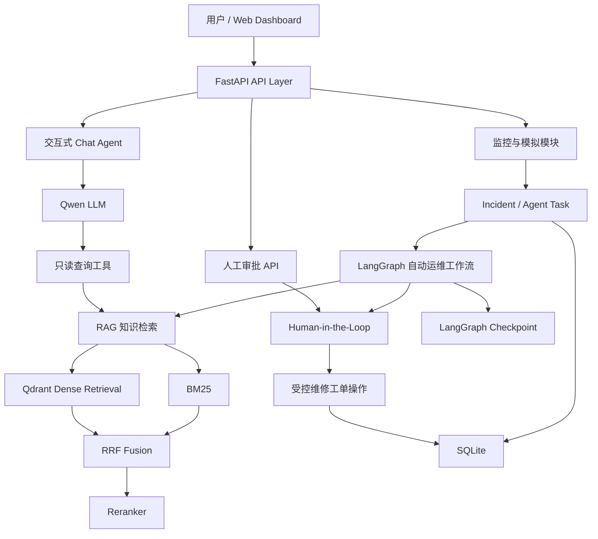

# Industrial Maintenance Agent

基于 FastAPI、LangGraph、Qwen 和 RAG 构建的工业设备智能运维 Agent 系统。

本项目面向工业设备监控与维护场景，尝试将设备状态监测、异常事件管理、AI 故障分析、知识库检索、人工审批和维修工单管理连接为一套可追踪的业务流程。

**项目定位：AI Agent 应用工程实践 / 求职作品集项目。**

> 本项目使用设备模拟数据展示工业运维业务流程，不直接连接真实工业控制设备，也不应直接用于生产设备的安全控制。

## 1. 项目背景

在工业运维场景中，设备异常通常涉及多个环节：

1. 监测设备状态并发现异常。
2. 记录故障事件和异常上下文。
3. 检索维修手册中的相关知识。
4. 根据业务规则判断是否需要人工介入。
5. 对高风险操作进行审批。
6. 在审批通过后创建维修工单。
7. 保存处理状态，并通过 Web 页面展示。

传统的单轮 AI 问答无法独立保证这些业务步骤的状态一致性、权限边界和执行可追踪性。

因此，本项目采用 **双入口 Agent 架构**：

- **自动运维入口**：围绕设备监测事件执行受控业务工作流。
- **人工交互入口**：允许用户通过自然语言查询设备、异常事件、维修工单和知识库。

## 2. 系统架构



该图概括系统的主要职责与逻辑关系，并非每个 Python 函数的精确调用顺序。

## 3. 核心功能

### 3.1 设备监控与异常管理

系统包含设备模拟、监控、设备状态查询以及异常事件管理模块。

可针对模拟设备的异常信号创建 Incident，并使用 Agent Task 跟踪后续处理流程。

项目覆盖温度异常和设备故障代码等不同类型的事件。

### 3.2 LangGraph 自动运维工作流

使用 LangGraph 组织设备异常处理流程。

工作流包含风险判断、业务分支、故障知识查询、人工审批和后续业务处理等环节。

通过显式的状态流转和持久化检查点，支持需要人工介入的处理流程。

### 3.3 Human-in-the-Loop 人工审批

对于需要审批的任务，工作流可以暂停并等待人工决策。

系统提供审批服务及 FastAPI 审批接口，并使用 LangGraph Checkpoint 保存恢复所需的状态。

审批结果由业务服务进行校验，不直接交给 LLM 自行决定。

当前实现包含单进程内的同一任务审批互斥保护，但不提供跨进程分布式锁保证。

### 3.4 维修工单与幂等性

受控工作流可以调用维修工单创建工具。

针对携带 Incident ID 的工单创建路径，项目使用数据库约束和事务机制降低重复创建风险。

需要注意：

- Agent Task 完成不等于 Incident 已关闭。
- 维修工单创建成功不等于实际维修已经完成。
- 工单创建工具自身不是完整的审批权限系统，权限控制依赖调用它的受控工作流。

### 3.5 交互式 Chat Agent

交互式 Agent 使用 Qwen 聊天模型和 LangChain Tool Calling。

当前绑定给 LLM 的工具包括：

- 设备状态查询
- 温度历史查询
- 维修知识检索
- Incident 查询
- 维修工单查询

维修工单创建工具未绑定到聊天模型的 Tool Calling 接口中，避免普通对话直接调用这一写入能力。

### 3.6 RAG 故障知识库

使用工业设备维修手册作为知识来源。

检索链路包括：

1. PDF 加载与章节解析
2. 文档 Chunking
3. BM25 关键词检索
4. Qdrant Dense 向量检索
5. RRF 排名融合
6. Reranker 重排序
7. 上层故障代码过滤及证据校验

RRF 使用排序位置而非直接混合 BM25 和向量检索的原始分数：

\[
RRF(d)=\sum_{r \in R(d)}\frac{1}{60+\operatorname{rank}_r(d)}
\]

Reranker 再对融合得到的候选内容进行相关性排序。

项目对故障知识证据进行额外检查，以降低不相关内容直接影响业务决策的风险。

这些机制不能完全消除大模型幻觉。

### 3.7 Web Dashboard

项目包含基于 HTML / JavaScript 的 Web 页面。

通过 FastAPI 提供静态资源和业务接口，展示设备运维相关信息，并支持系统交互。

## 4. 技术栈

| 层次 | 技术 |
|---|---|
| 编程语言 | Python 3.10.11 |
| Web 后端 | FastAPI、Uvicorn、Pydantic |
| Agent 编排 | LangGraph |
| 大模型调用 | LangChain OpenAI、OpenAI SDK |
| 聊天模型 | Qwen3.7-Plus |
| 文本向量模型 | Qwen3.7 Text Embedding |
| 文本重排模型 | Qwen3.7 Text Rerank |
| 向量存储 | Qdrant Local Mode |
| 关键词检索 | BM25、jieba |
| 融合排序 | Reciprocal Rank Fusion |
| 数据存储 | SQLite |
| 工作流持久化 | LangGraph SQLite Checkpoint |
| 文档处理 | PyMuPDF |
| 前端 | HTML、CSS、JavaScript |

模型 ID 和服务可用区域应以实际使用的百炼账号配置为准。

## 5. 项目目录

```text
industrial-maintenance-agent/
|
|-- app/                    # Core application
|   |-- agent/             # Agent graphs and LLM
|   |-- api/               # FastAPI endpoints
|   |-- incidents/         # Incident management
|   |-- models/            # Reserved package
|   |-- monitoring/        # Monitoring and simulation
|   |-- nodes/             # LangGraph nodes
|   |-- notifications/     # Notifications
|   |-- rag/               # RAG pipeline
|   |-- routers/           # Workflow routing
|   |-- state/             # Agent state
|   |-- tasks/             # Tasks and approval
|   |-- tools/             # Agent tools
|   |-- web/               # Frontend
|
|-- scripts/
|   |-- build_rag_index.py
|   |-- device_simulator.py
|   |-- evaluate_evidence_gate.py
|   |-- init_db.py
|
|-- tests/                  # 28 test scripts
|   |-- __init__.py
|   |-- test_*.py
|
|-- examples/
|   |-- devices.example.json
|
|-- data/                   # Local runtime data (ignored)
|-- .env.example
|-- .gitignore
|-- requirements.txt
|-- README.md
```

历史调试文件已保存在项目之外的本地归档目录，不属于正式交付内容。

## 6. 本地环境准备

以下以 Windows PowerShell 为例。

### 6.1 获取源码

```powershell
git clone <YOUR_REPOSITORY_URL>
cd industrial-maintenance-agent
```

将 `<YOUR_REPOSITORY_URL>` 替换为实际 GitHub 仓库地址。

### 6.2 创建虚拟环境

建议使用 Python 3.10.11。

```powershell
python -m venv .venv
```

激活虚拟环境：

```powershell
.\.venv\Scripts\Activate.ps1
```

### 6.3 安装依赖

```powershell
python -m pip install -r requirements.txt
```

当前 requirements.txt 使用项目开发环境中记录的依赖版本。

尚未在全新虚拟环境中完成独立安装验证。

### 6.4 配置 API Key

如果 `.env` 尚不存在：

```powershell
Copy-Item .env.example .env
```

编辑 `.env`，填入自己的 DashScope API Key。

主要配置项：

```dotenv
DASHSCOPE_API_KEY=YOUR_API_KEY
DASHSCOPE_BASE_URL=https://dashscope.aliyuncs.com/compatible-mode/v1
DASHSCOPE_CHAT_MODEL=qwen3.7-plus
DASHSCOPE_EMBEDDING_MODEL=qwen3.7-text-embedding
DASHSCOPE_RERANK_MODEL=qwen3.7-text-rerank
```

请根据 API Key 所属地域和模型服务支持情况配置接口地址。

注意：

- 不要将真实 `.env` 上传 GitHub。
- 导入 `app.config` 时会检查 `DASHSCOPE_API_KEY` 是否存在。
- 当前 Reranker 的 HTTP 接口地址定义在 `app/rag/reranker.py` 内。
- 当前代码不会读取 `.env` 中的 `DASHSCOPE_RERANK_URL`。

### 6.5 准备模拟设备配置

项目使用 `data/devices.json` 保存设备基础配置。

首次克隆仓库后，在项目根目录执行：

```powershell
New-Item -ItemType Directory -Path .\data -Force
Copy-Item .\examples\devices.example.json .\data\devices.json
```

如果已有 `data/devices.json`，不要直接覆盖，以免丢失原有配置。

示例包含 RB-001、RB-002、RB-003、RGV-001 四台模拟设备及温度报警阈值。

该文件提供静态设备配置，不代表 SQLite 中的实时监控状态。

## 7. 准备 RAG 知识库

### 7.1 知识库文件

默认 PDF 文件路径为：

```text
data/knowledge/raw/industrial_robot_maintenance_manual.pdf
```

本项目的本地运行数据目录 `data/` 被 `.gitignore` 排除。

因此，克隆仓库后需要自行准备具有使用权限的维修手册 PDF。

在 PowerShell 中创建目录：

```powershell
New-Item -ItemType Directory `
    -Force `
    -Path .\data\knowledge\raw
```

将维修手册放入上述目录，并使用代码预期的文件名。

**注意：** 当前章节解析器针对项目采用的维修手册结构开发。替换为其他 PDF 后，章节切分、报警代码提取和检索测试结果可能不同，不保证直接兼容任意 PDF。

### 7.2 构建 Qdrant 向量索引

在项目根目录执行：

```powershell
python -m scripts.build_rag_index
```

此脚本会：

1. 读取 PDF。
2. 划分章节并生成 Chunk。
3. 批量调用 Embedding API。
4. 创建本地 Qdrant Collection。
5. 写入文本、向量和元数据。

Qdrant 配置：

```text
Storage:    data/qdrant
Collection: industrial_maintenance_knowledge
Dimensions: 1024
Distance:   Cosine
```

**重要：索引构建脚本会删除已有的目标 Collection，然后重新创建。**

不要在已有重要数据时随意重复执行，也不要在其他进程占用同一个 Qdrant Local 存储目录时重建索引。

索引构建需要有效的模型 API Key，可能产生 API 调用费用。

### 7.3 SQLite 数据准备

项目使用 SQLite 保存不同业务模块的数据，并使用 SQLite 持久化 LangGraph Checkpoint。

仓库提供 `scripts/init_db.py` 初始化辅助脚本。

注意：scripts/init_db.py 包含清空温度历史和维修工单的 SQL 操作。不要在保存有重要业务数据的数据库上直接运行。首次部署的完整数据库初始化流程仍需独立验证。

克隆项目后不会自动获得开发机上的 Incident、Task、工单及历史监控数据。

## 8. 启动 FastAPI

在项目根目录执行：

```powershell
python -m uvicorn app.api.main:app --host 127.0.0.1 --port 8000
```

默认访问地址：

| 页面 | 地址 |
|---|---|
| Web Dashboard | http://127.0.0.1:8000/ |
| FastAPI 文档 | http://127.0.0.1:8000/docs |
| HTTP 健康检查 | http://127.0.0.1:8000/health |

健康检查返回示例：

```json
{
  "status": "ok",
  "service": "industrial-maintenance-agent"
}
```

`/health` 仅用于检查 HTTP 应用是否响应，不代表模型 API、Qdrant 和所有业务模块均正常。

首次启动前应先准备环境变量及所需本地资源。

## 9. API 设计

FastAPI 目前注册以下业务 Router：

| Router | 业务领域 |
|---|---|
| dashboard_router | 设备状态和历史数据 |
| operations_router | Incident、Agent Task 等 |
| approval_router | 人工审批 |
| simulation_router | 模拟设备及运行控制 |
| chat_router | Agent 对话 |
| notification_router | 异常通知 |

具体接口路径及请求参数请以 `/docs` 中的 OpenAPI 文档为准。

已确认的审批接口：

```text
POST /api/tasks/{task_id}/approval
```

审批请求包含 `approved` 布尔字段。

审批接口会检查任务是否存在、风险类型是否允许审批以及当前任务状态，避免对已完成任务重复执行审批恢复。

## 10. 测试与验证

项目包含针对监控、Incident、Agent Task、RAG、工单和审批流程的测试脚本。

开发阶段已进行包括以下内容的验证：

- 温度及设备故障事件回归
- Agent Task 状态流转
- RAG 故障代码证据检查
- 维修工单 Incident 级幂等性
- 人工审批通过与拒绝
- LangGraph Checkpoint 持久化恢复
- 单进程内并发审批控制
- FastAPI 审批接口隔离测试

部分测试使用模拟 LLM、Mock 工作流或临时 SQLite 数据库。

这些测试的通过结果不等价于完整生产部署验证。

以下为部分独立测试的运行方式：

```powershell
python -m tests.test_ticket_idempotency
python -m tests.test_approval_resume_isolated
python -m tests.test_approval_checkpoint_recovery
python -m tests.test_approval_concurrency_isolated
python -m tests.test_approval_api_isolated
```

部分其他测试会调用真实外部模型 API，执行前应了解其费用和本地数据影响。

## 11. 主要工程设计

### 11.1 读写工具分离

LLM 只绑定查询工具。

创建维修工单等写入操作由受控工作流调用。

### 11.2 人工审批

使用 LangGraph 中断和恢复机制，将人工确认纳入执行流程。

### 11.3 状态管理

通过持久化 Task、Incident 和 Checkpoint 分别维护业务状态与工作流状态。

### 11.4 工单幂等性

通过数据库约束和事务减少同一个 Incident 对应的重复工单创建。

### 11.5 检索证据约束

使用 Hybrid Retrieval、Rerank 和证据校验提高故障知识检索的可用性。

## 12. 当前限制

本项目目前仍属于本地开发与演示系统：

1. 本地 Qdrant 存储不适合未经设计的多进程并发访问。
2. 同任务审批互斥基于进程内锁，不保证多个服务进程之间的互斥。
3. 索引重建会删除原有 Qdrant Collection，尚未采用无损切换机制。
4. 工单操作的审批约束依赖受控工作流，而非工具自身独立鉴权。
5. 部分外部模型调用依赖第三方服务可用性，可能产生费用。
6. 提供的模拟数据不代表真实生产设备数据。
7. 尚未完成全新环境的一键部署验收及生产级安全测试。
8. 私有运行数据与原始 PDF 未包含在仓库中，完整演示需要补充相应资源。

## 13. 后续改进方向

在不改变当前项目交付范围的前提下，可考虑：

- Docker 化部署
- 多进程或分布式审批互斥机制
- 工单工具级权限校验
- RAG 索引无损更新
- 自动化 CI 回归测试
- 日志、指标和链路追踪
- 标准化演示数据集

这些属于未来方向，不代表当前已经实现。

## 14. 项目说明

本项目用于展示 AI Agent 应用工程中的业务工作流设计、LLM 工具权限控制、RAG 检索、状态持久化、人工审批和幂等性处理。

项目不提供对真实工业控制设备的直接操作能力。

在实际生产环境应用前，需要进一步完成权限、安全、可靠性、审计和部署验证。
